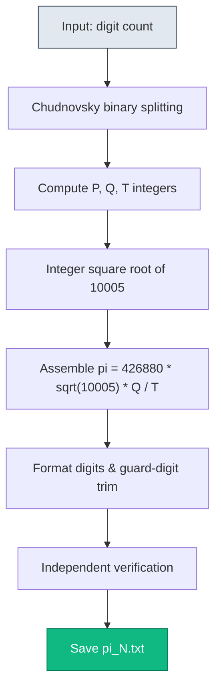

<p align="center">
  
</p>

<p align="center">
  <a href="https://github.com/zomop/PiProject/actions/workflows/ci.yml">
    
  </a>
  
  
  
  
</p>

<p align="center">
  <b>PiProject</b> — High-precision π computation and independent verification
  <br/>Chudnovsky algorithm · Binary splitting · GMPY2 · BBP spot checks
</p>

---

# PiProject

**PiProject** computes **π (pi)** to millions of digits using the **Chudnovsky
algorithm** with **binary splitting** and **GMPY2** arbitrary-precision
arithmetic, and verifies results through an **independent verification engine**
that never trusts the computation engine.

## The math

PiProject uses the [Chudnovsky algorithm](https://en.wikipedia.org/wiki/Chudnovsky_algorithm),
one of the fastest known methods for computing π:

```math
\frac{1}{\pi} =
12 \sum_{k=0}^{\infty}
\frac{(-1)^k (6k)! \left(545140134k + 13591409\right)}
{(3k)! (k!)^3 \left(640320\right)^{3k + 3/2}}
```

Equivalently:

```math
\pi = \frac{426880 \sqrt{10005} \, Q}{T}
```

where `P`, `Q`, `T` come from [binary splitting](https://en.wikipedia.org/wiki/Binary_splitting)
over the Chudnovsky series — each term yields roughly **14 correct digits**.



## Features

- 🎯 High-precision calculation of π (millions of digits)
- ⚡ Chudnovsky algorithm + binary splitting
- 🔢 GMPY2 arbitrary-precision integer arithmetic
- 🔍 Independent verification engine with explicit statuses
- 🧮 BBP hexadecimal spot checks (algorithmically independent)
- 📄 Streaming output to `pi_<digits>.txt`
- 🖥️ Professional CLI: `piproject calculate/verify/benchmark/inspect/hash`
- 🧪 77 automated tests, CI on every push

## Installation

```bash
git clone https://github.com/zomop/PiProject.git
cd PiProject
pip install -r requirements.txt
pip install -e .          # install the `piproject` command
```

## Usage

### Calculate

```bash
piproject calculate --digits 1000000 --output pi_1000000.txt
```

Options:

| Option | Meaning |
|--------|---------|
| `--digits N` | number of decimal digits of π to calculate |
| `--output FILE` | output file (default: `pi_<digits>.txt`) |

### Verify

```bash
piproject verify --input pi_1000000.txt --reference reference.txt
```

Options:

| Option | Meaning |
|--------|---------|
| `--input FILE` | calculated pi file to verify |
| `--reference FILE` | reference file for full digit-by-digit comparison |
| `--bbp POSITIONS` | BBP spot-check positions (comma-separated, e.g. `1,10,100`) |

### Benchmark

```bash
piproject benchmark --digits 1000000 --repeats 3
```

### Inspect

```bash
piproject inspect --input pi_1000000.txt
```

### Hash

```bash
piproject hash --input pi_1000000.txt
```

## Verification Statuses

PiProject uses explicit, unambiguous verification statuses:

| Status | Meaning |
|--------|---------|
| `CALCULATED` | Value computed; no verification |
| `STRUCTURE_VALID` | Passes format/length/digit checks |
| `PREFIX_VERIFIED` | Matches known reference for checked prefix only |
| `FULLY_VERIFIED` | Every digit compared against a trustworthy reference |
| `INDEPENDENTLY_VERIFIED` | Confirmed by an independent algorithm (BBP) |
| `VERIFICATION_FAILED` | A mismatch or error was detected |

**Never** `FULLY_VERIFIED` from a prefix check alone.

## Verification Coverage

| Digits | Authoritative Check | Status |
|--------|-------------------|--------|
| ≤ 1,000 | All digits | `FULLY_VERIFIED` (built-in reference) |
| > 1,000 | First 1,000 digits | `PREFIX_VERIFIED` (built-in) |
| Any | All digits vs. external reference | `FULLY_VERIFIED` (with `--reference`) |

The built-in reference covers the first 1,000 decimal digits. For full
verification at scale, provide an external reference file with `--reference`.

## Verified Results

Independently cross-checked against decimal/Machin computation and the
IonicaBizau/pi-decimals reference:

| Digits | SHA-256 (decimal digits) | Method |
|--------|-------------------------|--------|
| 1,000 | `808b01bd…2292bd` | decimal/Machin + Chudnovsky match |
| 10,000 | `7406a2be…507ab5` | decimal/Machin + Chudnovsky match |
| 100,000 | `5ebe8007…482bc2` | decimal/Machin + Chudnovsky match |
| 1,000,000 | `7806ee47…bbf7069` | IonicaBizau/pi-decimals reference match |

## Documentation

- [`docs/architecture.md`](docs/architecture.md) — System architecture
- [`docs/algorithms.md`](docs/algorithms.md) — Chudnovsky, binary splitting, BBP
- [`docs/verification.md`](docs/verification.md) — Verification methodology
- [`docs/reproducibility.md`](docs/reproducibility.md) — Benchmarks & SHA-256 fingerprints

## Contributing

1. Fork the repository
2. Create a feature branch: `git checkout -b feature/amazing-feature`
3. Commit your changes: `git commit -m "Add amazing feature"`
4. Push to the branch: `git push origin feature/amazing-feature`
5. Open a Pull Request

## License

This project is open source. A `LICENSE` file has not yet been added —
the license terms are pending the repository owner's decision.

---

<p align="center">
  Made with ❤️ by <b>[zomop](https://github.com/zomop)</b>
</p>
