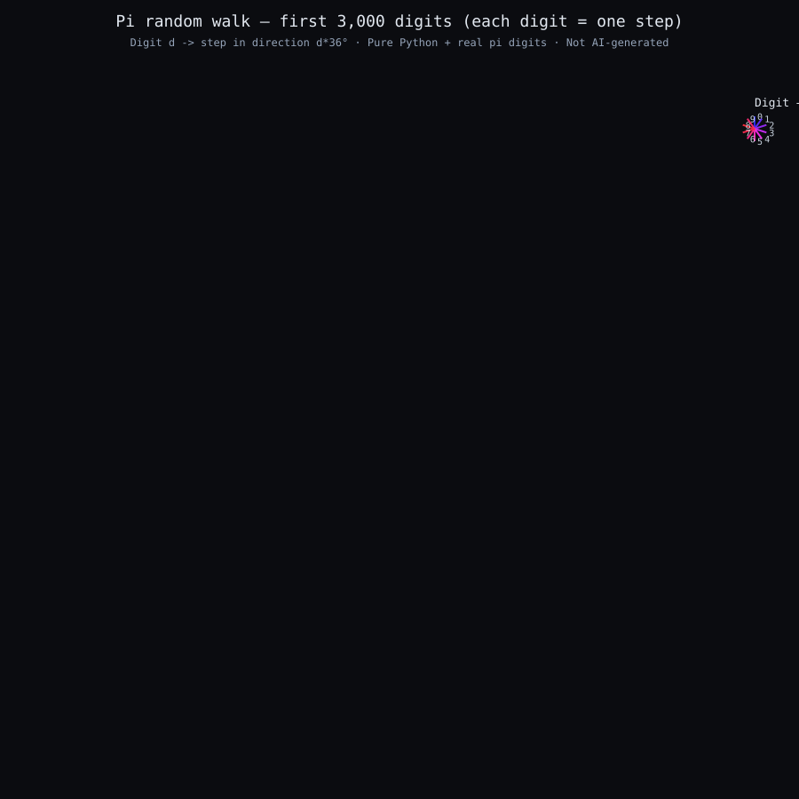
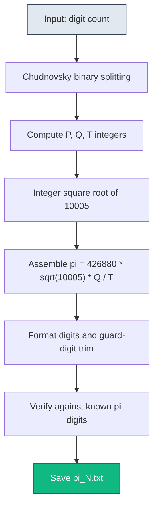

<p align="center">
  
</p>

<p align="center">
  <a href="https://github.com/zomop/PiProject/actions/workflows/ci.yml">
    
  </a>
  <a href="https://github.com/zomop/PiProject">
    
  </a>
  
  
</p>

<p align="center">
  <b>High-precision π computation in Python</b> · Chudnovsky algorithm · Binary splitting · GMPY2
</p>

---

# PiProject

**PiProject** is an open-source Python project for computing **π (pi)** to millions of digits with the
**Chudnovsky algorithm** and **binary splitting**, powered by **GMPY2** arbitrary-precision arithmetic.
It also verifies calculated digits against a reference. The project has calculated and verified
**10,000,000 digits of π with 0 mismatches**.

## The math

PiProject uses the [Chudnovsky algorithm](https://en.wikipedia.org/wiki/Chudnovsky_algorithm),
one of the fastest known methods for computing π:

```math
\frac{1}{\pi} =
12 \sum_{k=0}^{\infty}
\frac{(-1)^k (6k)! \left(545140134k + 13591409\right)}
{(3k)! (k!)^3 \left(640320\right)^{3k + 3/2}}
```

Equivalently,

```math
\pi = \frac{426880 \sqrt{10005} \, Q}{T}
```

where `P`, `Q`, `T` come from [binary splitting](https://en.wikipedia.org/wiki/Binary_splitting)
over the Chudnovsky series — each term yields roughly **14 correct digits**.



## Features

- 🎯 High-precision calculation of π (millions of digits)
- ⚡ Chudnovsky algorithm + binary splitting
- 🔢 GMPY2 arbitrary-precision integer arithmetic
- 🔍 Digit-by-digit reference verification
- 📄 Automatic output to `pi_<digits>.txt`
- 🧪 Tested & verified (47 tests, CI on every push)

## Installation

```bash
git clone https://github.com/zomop/PiProject.git
cd PiProject
pip install -r requirements.txt
```

## Usage

<details>
<summary><b>▶ Recommended calculator: <code>pi_project_v4.py</code></b> (click to expand)</summary>

Run interactively:

```bash
python pi_project_v4.py
```

Or non-interactively (handy for scripting and CI):

```bash
python pi_project_v4.py --digits 1000 --output pi_1000.txt
```

Options:

| Option | Meaning |
|--------|---------|
| `--digits N` | number of decimal digits of π to calculate |
| `--output FILE` | output file (default: `pi_<digits>.txt`) |

</details>

<details>
<summary><b>🔎 Verify against a reference</b> (click to expand)</summary>

```bash
python verify.py
```

This compares `pi_10000000.txt` against a downloaded 10,000,000-digit reference. Use a local file instead:

```bash
python verify.py --calculated pi_1000.txt \
  --reference tests/fixtures/pi_1000_reference.txt \
  --sha256 <expected>
```

The expected SHA-256 must be established from a trusted source — it is not hard-coded.

</details>

**Example output**

```text
3.14159265358979323846264338327950288419716939937510582097494459230781...
```

## Calculators compared

PiProject ships three implementations. Use `pi_project_v4.py` unless you have a specific reason not to.

| File | Algorithm | Dependencies | Best for | Notes |
|------|-----------|--------------|----------|-------|
| `pi_project_v4.py` | Chudnovsky + binary splitting | `gmpy2` | **Recommended**, millions of digits | Fastest, lowest memory at scale. Used by CI. |
| `pi_v3.py` | Chudnovsky + binary splitting | Python stdlib (`decimal`) | Medium digit counts | Pure Python, no external deps, but slower at scale. |
| `pie.py` | Machin-like arctan | Python stdlib (`decimal`) | Small digit counts only | Legacy, O(digits²). Impractical beyond a few thousand digits. |

## Contributing

<details>
<summary><b>👉 How to contribute</b> (click to expand)</summary>

1. Fork the repository.
2. Create a feature branch: `git checkout -b feature/amazing-feature`
3. Commit your changes: `git commit -m "Add amazing feature"`
4. Push to the branch: `git push origin feature/amazing-feature`
5. Open a Pull Request.

You can contribute by improving calculation performance, reducing memory usage,
improving verification, adding features, or improving documentation.

</details>

## FAQ

<details>
<summary><b>❓ How many digits can PiProject calculate?</b></summary>

Tested successfully with **10,000,000 digits of π**.

</details>

<details>
<summary><b>❓ How is π calculated?</b></summary>

The **Chudnovsky algorithm** with **binary splitting** and **GMPY2** arbitrary-precision arithmetic.
Each series term yields roughly 14 correct digits.

</details>

<details>
<summary><b>❓ Is the 10-million-digit result verified?</b></summary>

Yes. Compared against a reference of 10,000,000 characters —
**10,000,000 matches, 0 mismatches**.

</details>

<details>
<summary><b>❓ Can I modify the project?</b></summary>

Yes. PiProject is open source and may be studied, modified, and improved
according to the repository's license (see below).

</details>

## Roadmap / ideas

- Add more decimal-places benchmarks
- Parallelize binary splitting across CPU cores
- Add a web demo / WASM build
- More digit visualizations like `assets/pi-random-walk.svg`

## Acknowledgments

- **GMPY2** — High-performance arbitrary-precision arithmetic
- **Chudnovsky Brothers** — Chudnovsky algorithm for calculating π
- **Python** — Programming language used for the project
- Reference data used for verification

## License

This project is open source. A `LICENSE` file has not yet been added —
the license terms are pending the repository owner's decision
(no MIT or other license was selected without authorization).

---

<p align="center">
  Made with ❤️ by <b>[zomop](https://github.com/zomop)</b> ·
  September 8, 2026
</p>
